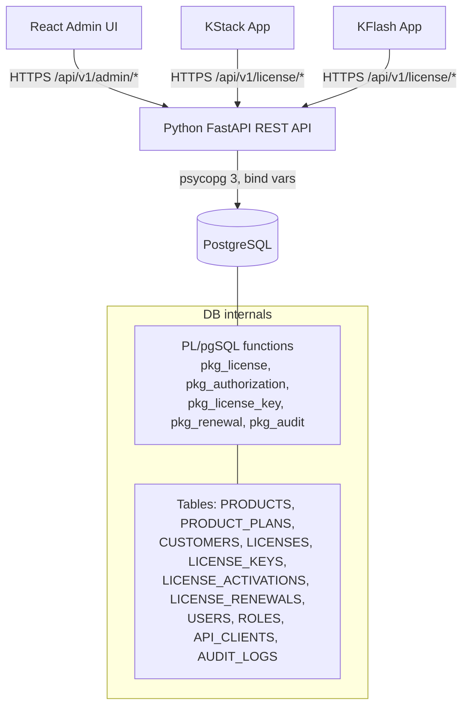
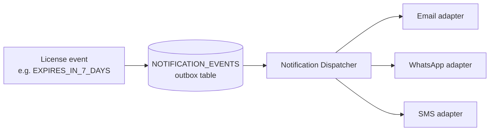

# Karnex License Authorization System — Architecture

Version 1.0 · 2026-08-26 · Status: Approved baseline

## 1. Purpose

Central License Authorization & Management System for Karnex software products (initially **KStack** and **KFlash**). It is the single source of truth for license authorization. Products never decide authorization locally; they ask the central API.

## 2. Technology Stack

| Layer | Technology | Notes |
|---|---|---|
| Admin UI | React 18 + TypeScript (Vite), Tailwind CSS 3 | SPA, talks only to the REST API |
| API | Python 3.10+, FastAPI (served by uvicorn) | Thin secure gateway; no business rules for license state |
| DB access | psycopg 3 (`psycopg_pool`), connection pool | Calls PL/pgSQL functions via bind variables only |
| Database | PostgreSQL 14+ | All license business logic in PL/pgSQL functions (one schema per package: pkg_license, pkg_authorization, ...) |
| Auth (admin) | Username/password (bcrypt) → signed JWT access token | Simple login per requirement; RBAC enforced server-side |
| Auth (products) | API client ID + secret (hashed) → per-request auth | KStack/KFlash use client credentials, never admin auth |

## 3. System Overview



## 4. Layer Responsibilities

**React Admin UI** — presentation only. Never holds database credentials, API-client secrets, or license decision logic. Receives only what the API returns.

**Python API** — authentication (admin JWT, API-client credentials), input validation (`app/schema.py`), rate limiting, request correlation IDs, standardized responses, CORS/security headers, and translation of HTTP requests into PL/pgSQL function calls. Returns machine-readable error codes; never raw database errors.

**PL/pgSQL functions** — all license lifecycle rules: state transitions, key generation, activation allocation (with `SELECT ... FOR UPDATE` row locking for concurrency safety), renewal history, audit writes. This guarantees rules hold even if a second API instance or a DBA tool touches the data.

**PostgreSQL schema** — normalized entities with FK/unique/check constraints as the last line of defense (e.g., unique license key, activation-count check).

## 5. Extensibility

Products and plans are **data**, not code:

- Adding KINVENTORY/KBILLING/etc. = insert a PRODUCTS row + PRODUCT_PLANS rows + an API_CLIENTS row. No engine changes.
- Plan durations (TRIAL=15 etc.) live in PRODUCT_PLANS.DURATION_DAYS, never in code.
- License-key prefix is a PRODUCTS column (`KEY_PREFIX`), e.g. KSTK, KFLH.

## 6. Notification Architecture (future-ready)

The licensing engine emits domain events into `NOTIFICATION_EVENTS` (outbox pattern). A separate dispatcher (future) reads events and delivers via provider adapters (Email / WhatsApp / SMS / in-app). License logic never calls a provider directly.



## 7. Offline Authorization Model

Products validate periodically, not per-second. The server returns, with every successful validate/heartbeat: `lastAuthorizedAt`, `offlineGraceDays` (configurable in SETTINGS, per product-plan overridable), and `nextValidationDeadline`. The client SDK caches the signed response locally; if the deadline passes without a successful revalidation, the product locks. The cache is server-signed (HMAC) so it cannot be forged by editing a file. See LICENSE_FLOW.md §6.

## 8. Repository Layout

```
/docs                      Architecture & design documents
/database/postgres         PostgreSQL schema, functions, seed (numbered), pgAdmin guide
/backend                   Python (FastAPI) REST API
/frontend                  React + TypeScript admin dashboard (Tailwind CSS)
/integration-examples      KStack/KFlash client integration SDK examples
```

## 9. Key Decisions (accepted)

1. Backend: Python 3.10+ + FastAPI (replaced the original Node.js + TypeScript server, Oct 2026, with the same HTTP API; user decision).
2. Business logic: database functions (PL/pgSQL); API is thin (user decision).
3. Admin auth: basic username/password login with hashed passwords + signed token (user decision: "basic login logic").
4. Database: PostgreSQL 14 or newer (replaced Oracle 19c, Oct 2026) — identity columns, no extensions required.
5. License ≠ license key: separate entities; keys can be regenerated with full history.
6. Append-only audit: application code has INSERT-only access pattern for AUDIT_LOGS.
