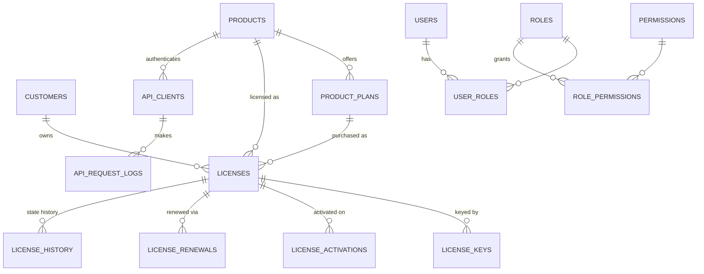
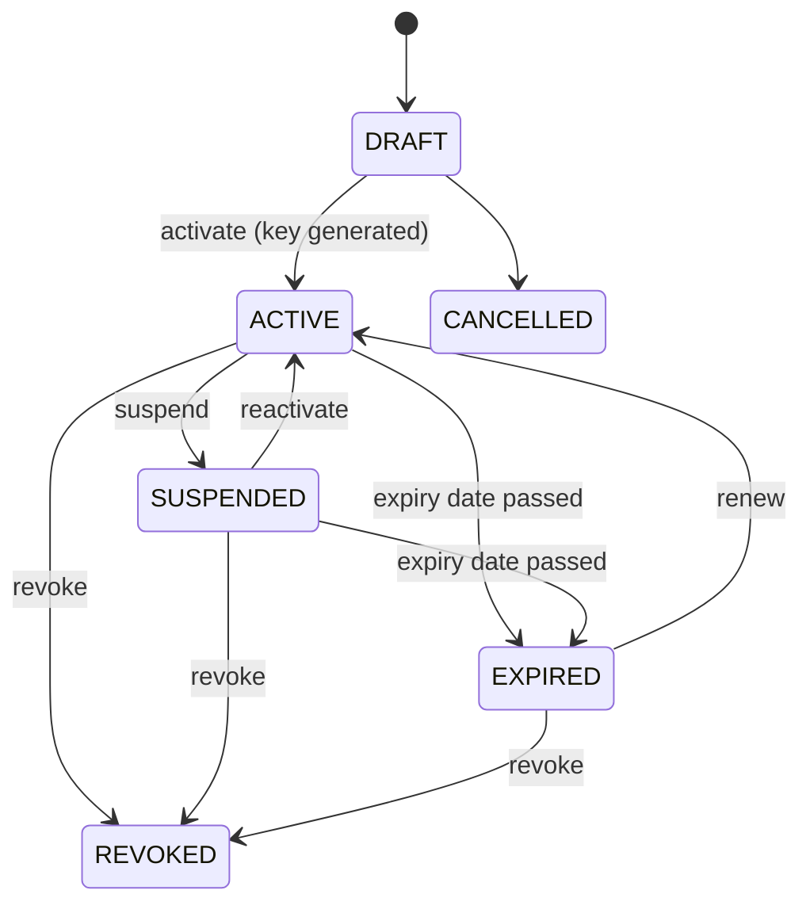

# Database Design — PostgreSQL

> The database moved from Oracle to PostgreSQL in October 2026. The entity design below is unchanged; the authoritative DDL is `database/postgres/001_schema.sql` (types: NUMBER→BIGINT/INTEGER/NUMERIC, VARCHAR2→VARCHAR, CLOB→TEXT, TIMESTAMP→TIMESTAMPTZ; packages → PL/pgSQL functions in schemas of the same name). Setup with pgAdmin: `database/postgres/README.md`.

All tables use identity PKs, `CREATED_AT`/`UPDATED_AT` (TIMESTAMP), and `CREATED_BY`/`UPDATED_BY` (FK USERS) where meaningful. Naming: `UPPER_SNAKE`. Migrations are numbered scripts in `/database/migrations`.

## 1. Entity Relationship Overview

## 2. Tables

### PRODUCTS
| Column | Type | Constraints |
|---|---|---|
| PRODUCT_ID | NUMBER identity | PK |
| PRODUCT_CODE | VARCHAR2(30) | UNIQUE, NOT NULL (e.g. KSTACK) |
| PRODUCT_NAME | VARCHAR2(100) | NOT NULL |
| KEY_PREFIX | VARCHAR2(6) | UNIQUE, NOT NULL (e.g. KSTK) — used in license keys |
| DESCRIPTION | VARCHAR2(1000) | |
| VERSION | VARCHAR2(30) | |
| STATUS | VARCHAR2(20) | CHECK IN ('ACTIVE','INACTIVE'), default ACTIVE |
| CREATED_AT / UPDATED_AT / CREATED_BY / UPDATED_BY | | |

### PRODUCT_PLANS
PLAN_ID PK · PRODUCT_ID FK NOT NULL · PLAN_CODE (UNIQUE per product: `UQ(PRODUCT_ID, PLAN_CODE)`) · PLAN_NAME · DURATION_DAYS NUMBER NULL (NULL = lifetime) · IS_LIFETIME CHAR(1) CHECK Y/N · PRICE NUMBER(12,2) · CURRENCY VARCHAR2(3) default 'INR' · MAX_ACTIVATIONS NUMBER NOT NULL default 1 · MAX_USERS · MAX_BRANCHES · STATUS CHECK ('ACTIVE','INACTIVE') · timestamps/users.
CHECK: `(IS_LIFETIME='Y' AND DURATION_DAYS IS NULL) OR (IS_LIFETIME='N' AND DURATION_DAYS > 0)`.

### CUSTOMERS
CUSTOMER_ID PK · CUSTOMER_CODE UNIQUE NOT NULL · COMPANY_NAME NOT NULL · CONTACT_PERSON · EMAIL · MOBILE · WHATSAPP · ADDRESS_LINE1/2 · CITY · STATE · COUNTRY · GST_NUMBER · STATUS CHECK ('ACTIVE','INACTIVE') · timestamps/users. Index on UPPER(COMPANY_NAME), EMAIL, MOBILE for search.

### CUSTOMER_CONTACTS
CONTACT_ID PK · CUSTOMER_ID FK · NAME · ROLE · EMAIL · MOBILE · IS_PRIMARY CHAR(1) · timestamps.

### LICENSES
| Column | Notes |
|---|---|
| LICENSE_ID | PK |
| LICENSE_NO | UNIQUE NOT NULL, format `LIC-YYYY-NNNNNN` (sequence-based; display only, not secret) |
| CUSTOMER_ID / PRODUCT_ID / PLAN_ID | FKs NOT NULL |
| STATUS | CHECK IN ('DRAFT','ACTIVE','SUSPENDED','EXPIRED','REVOKED','CANCELLED') |
| START_DATE / EXPIRY_DATE | EXPIRY_DATE NULL = lifetime |
| MAX_ACTIVATIONS / MAX_USERS / MAX_BRANCHES | copied from plan at creation (plan changes don't retro-affect sold licenses) |
| CURRENT_ACTIVATIONS | NUMBER default 0, CHECK `CURRENT_ACTIVATIONS BETWEEN 0 AND MAX_ACTIVATIONS` — DB-level guard against over-activation |
| AUTO_RENEWAL | CHAR(1) Y/N |
| NOTES | VARCHAR2(2000) |
| timestamps/users | |

### LICENSE_KEYS
KEY_ID PK · LICENSE_ID FK NOT NULL · LICENSE_KEY VARCHAR2(40) **UNIQUE** NOT NULL · KEY_HASH VARCHAR2(64) (SHA-256, for lookup without exposing key in index dumps — key itself stored for admin display per business need) · STATUS CHECK ('ACTIVE','REVOKED') · GENERATED_AT · GENERATED_BY · REVOKED_AT.
Only one ACTIVE key per license: function-based unique index on `CASE WHEN STATUS='ACTIVE' THEN LICENSE_ID END`.

### LICENSE_ACTIVATIONS
ACTIVATION_ID PK · LICENSE_ID FK NOT NULL · INSTALLATION_ID VARCHAR2(100) NOT NULL (client-generated stable ID) · DEVICE_ID · MACHINE_FINGERPRINT VARCHAR2(128) · DEVICE_NAME · OS_INFO · APP_VERSION · IP_ADDRESS VARCHAR2(45) · STATUS CHECK ('ACTIVE','DEACTIVATED') · ACTIVATED_AT · LAST_HEARTBEAT_AT · DEACTIVATED_AT · DEACTIVATED_BY · DEACTIVATION_REASON.
One ACTIVE row per (LICENSE_ID, INSTALLATION_ID): function-based unique index. Re-activation of a previously deactivated installation inserts a new row (history preserved).

### LICENSE_RENEWALS
RENEWAL_ID PK · LICENSE_ID FK · PREV_PLAN_ID · NEW_PLAN_ID · PREV_EXPIRY_DATE · NEW_EXPIRY_DATE · RENEWAL_DATE · AMOUNT · CURRENCY · PAYMENT_REF · PERFORMED_BY FK USERS · NOTES.

### LICENSE_HISTORY
HISTORY_ID PK · LICENSE_ID FK · OLD_STATUS · NEW_STATUS · CHANGED_AT · CHANGED_BY · REASON · REQUEST_ID. Written by PKG_LICENSE on every transition.

### USERS / ROLES / PERMISSIONS / USER_ROLES / ROLE_PERMISSIONS
USERS: USER_ID PK · USERNAME UNIQUE · EMAIL UNIQUE · FULL_NAME · PASSWORD_HASH (bcrypt, never plaintext) · STATUS ('ACTIVE','LOCKED','INACTIVE') · LAST_LOGIN_AT · FAILED_ATTEMPTS · timestamps.
ROLES: ROLE_CODE UNIQUE (ADMIN, MANAGER, VIEWER). PERMISSIONS: PERM_CODE UNIQUE (e.g. LICENSE_CREATE, LICENSE_REVOKE, CUSTOMER_MANAGE, USER_MANAGE, AUDIT_VIEW, SETTINGS_MANAGE...). Junctions with composite UNIQUE constraints.

### API_CLIENTS
CLIENT_ID PK · PRODUCT_ID FK NOT NULL · CLIENT_KEY VARCHAR2(64) UNIQUE (public identifier) · SECRET_HASH VARCHAR2(100) (bcrypt — plaintext secret shown once at creation, never stored) · NAME · STATUS ('ACTIVE','REVOKED') · LAST_USED_AT · timestamps.

### API_REQUEST_LOGS
LOG_ID PK · REQUEST_ID VARCHAR2(36) · CLIENT_ID FK NULL · ENDPOINT · METHOD · LICENSE_KEY_HASH (never raw key) · RESULT_CODE · HTTP_STATUS · IP_ADDRESS · DURATION_MS · CREATED_AT. Insert-only; purge policy via scheduled job (retention configurable).

### AUDIT_LOGS
AUDIT_ID PK · USER_ID FK NULL · ACTOR VARCHAR2(100) (username or client key) · ACTION VARCHAR2(50) (CUSTOMER_CREATED, LICENSE_REVOKED, KEY_REGENERATED, ...) · ENTITY_TYPE · ENTITY_ID · REQUEST_ID · IP_ADDRESS · BEFORE_STATE CLOB (JSON) · AFTER_STATE CLOB (JSON) · CREATED_AT. **Append-only**: no UPDATE/DELETE grants to app schema role; written via PKG_AUDIT.

### SETTINGS
SETTING_KEY PK VARCHAR2(50) · SETTING_VALUE VARCHAR2(500) · DESCRIPTION · UPDATED_AT/BY. Seeded: `OFFLINE_GRACE_DAYS=7` (configurable), `HEARTBEAT_INTERVAL_HOURS=24`, `EXPIRY_WARN_DAYS=30,15,7`.

### NOTIFICATION_EVENTS (outbox)
EVENT_ID PK · EVENT_TYPE · ENTITY_TYPE · ENTITY_ID · CUSTOMER_ID · PAYLOAD CLOB JSON · STATUS ('PENDING','SENT','FAILED','SKIPPED') · CREATED_AT · PROCESSED_AT.

## 3. Concurrency Design (activation)

`PKG_AUTHORIZATION.ACTIVATE_LICENSE`:
1. `SELECT ... FROM LICENSES WHERE LICENSE_ID = :id FOR UPDATE` — serializes concurrent activations per license.
2. Re-check status, expiry, `CURRENT_ACTIVATIONS < MAX_ACTIVATIONS` under the lock.
3. Insert activation row; `UPDATE LICENSES SET CURRENT_ACTIVATIONS = CURRENT_ACTIVATIONS + 1`.
4. The CHECK constraint on CURRENT_ACTIVATIONS and the function-based unique index on active (LICENSE_ID, INSTALLATION_ID) are DB-level backstops: even a buggy code path cannot create a 6th slot of 5 or a duplicate active install.
5. COMMIT is controlled by the package caller (one transaction per API request).

## 4. Status State Machines

REVOKED and CANCELLED are terminal. Transitions enforced in `PKG_LICENSE.CHANGE_STATUS`; any other transition raises `-20050 INVALID_STATE_TRANSITION`.

## 5. Indexing Summary

FK columns indexed; UPPER() function indexes for name/email search; LICENSES(EXPIRY_DATE) for expiring-soon queries; AUDIT_LOGS(ENTITY_TYPE, ENTITY_ID), (CREATED_AT); API_REQUEST_LOGS(CREATED_AT).

## 6. Migration Strategy

Numbered scripts in `database/postgres/` (`001_schema.sql`, `002_functions.sql`, `003_seed.sql`, later `004_...`) applied in order by `python -m scripts.db_migrate` (run in `backend/`; `start.bat` does it on every start), which records each in `schema_migrations` (or manually with `psql -f run_all.sql` / pgAdmin's Query Tool). Schema changes always ship as new migration scripts, never edits to applied ones.
