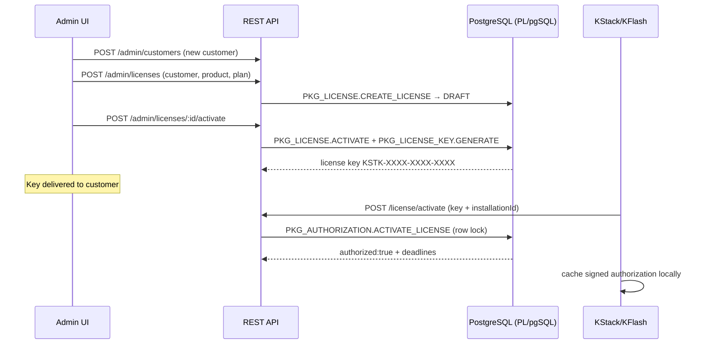
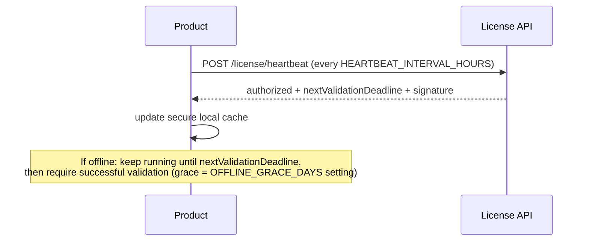

# License Flows

## 1. License Sale → Activation Lifecycle

## 2. Server-side Activation Checks (in order)

1. API client authenticated (`UNAUTHORIZED_CLIENT`), rate limit ok (`RATE_LIMITED`), payload valid (`VALIDATION_ERROR`), timestamp fresh (replay guard).
2. Key exists & key status ACTIVE → else `INVALID_LICENSE` / `KEY_REVOKED`.
3. Key's license belongs to requested product AND to the API client's product → else `INVALID_PRODUCT`.
4. License status ACTIVE → else `LICENSE_SUSPENDED` / `LICENSE_REVOKED` / `LICENSE_NOT_ACTIVE`.
5. Not expired (`EXPIRY_DATE` NULL = lifetime) → else `LICENSE_EXPIRED` (status auto-transitions to EXPIRED).
6. Same installationId already ACTIVE → return existing activation (idempotent success).
7. Slot available under `SELECT FOR UPDATE` lock → else `ACTIVATION_LIMIT_REACHED`.
8. Insert activation, increment counter, write audit, commit.

## 3. Periodic Validation & Heartbeat

## 4. Renewal

Admin: `POST /admin/licenses/:id/renew` `{ planId?, amount?, paymentRef?, notes? }`.
`PKG_RENEWAL.RENEW_LICENSE`: computes new expiry = GREATEST(SYSDATE, old expiry) + plan duration; inserts LICENSE_RENEWALS row (prev/new expiry, plan, amount, performed_by) — history is never overwritten; sets status ACTIVE if EXPIRED; writes LICENSE_HISTORY + AUDIT_LOGS; emits LICENSE_RENEWED notification event.

## 5. Suspend / Reactivate / Revoke / Regenerate Key

- Suspend: ACTIVE→SUSPENDED (reason required). Products receive `LICENSE_SUSPENDED` on next validate/heartbeat and lock.
- Reactivate: SUSPENDED→ACTIVE.
- Revoke: terminal; all active key rows set REVOKED; activations remain as history.
- Regenerate key: old key REVOKED, new key issued (same license/activations). Customer re-enters key; validate accepts new key against existing installationId.
- Deactivate activation (admin or product): slot decremented under the same row lock, becomes available immediately.

## 6. Offline Authorization Model

Server returns with every successful authorization: `lastAuthorizedAt`, `offlineGraceDays`, `nextValidationDeadline = lastAuthorizedAt + offlineGraceDays`, and an HMAC `signature` over `(licenseKey, installationId, status, expiryDate, nextValidationDeadline)` using a per-client signing secret. The product SDK stores this blob; on offline startup it verifies the signature and the deadline. Tampering invalidates the signature; clock rollback is mitigated by storing the last-seen wall clock and refusing regressions. This is deterrence-grade (client-side enforcement can never be absolute); real authority stays server-side.

## 7. Expiry Handling

Expiry is evaluated lazily on every authorization call (authoritative) plus a scheduled job (`PKG_LICENSE.EXPIRE_DUE_LICENSES` via DBMS_SCHEDULER, daily) that flips overdue ACTIVE/SUSPENDED→EXPIRED and emits expiry-warning events at 30/15/7 days (SETTINGS-driven).
